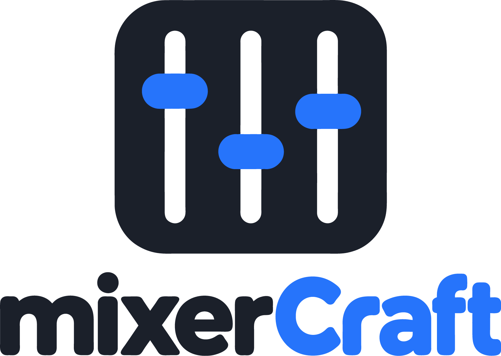
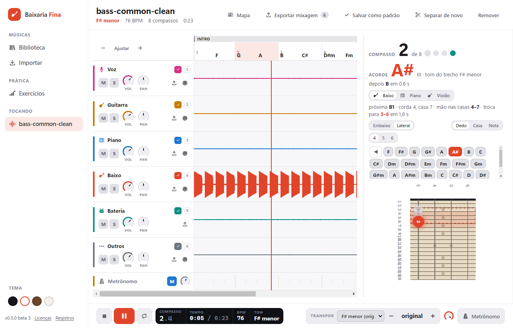

<p align="center">
  
</p>

<h1 align="center">mixerCraft</h1>

<p align="center">
  <b>Separe as faixas de qualquer música, veja a harmonia e aprenda a linha de baixo no braço e no teclado.</b>
</p>

<p align="center">
  
  
  
  
  
</p>



---

## Sumário

- [O que é](#o-que-é)
- [Recursos](#recursos)
- [Início rápido](#início-rápido)
- [Requisitos](#requisitos)
- [Ferramentas externas](#ferramentas-externas)
- [Como o áudio é processado](#como-o-áudio-é-processado)
- [Estrutura do projeto](#estrutura-do-projeto)
- [Testes e verificação](#testes-e-verificação)
- [Instalador](#instalador)
- [Documentação](#documentação)
- [Limitações conhecidas](#limitações-conhecidas)
- [Licença e créditos](#licença-e-créditos)

---

## O que é

O **mixerCraft** é um aplicativo de estudo para baixistas (e para quem toca com eles). Você escolhe uma música, o app separa os instrumentos, descobre o andamento, os compassos e os acordes, e mostra a linha de baixo na posição certa do braço. Tudo roda no seu computador, sem enviar as músicas para a internet.

## Recursos

**Entrada**
- Importa um arquivo de áudio ou um link do YouTube (via `yt-dlp`).
- Ferramenta **Baixar MP3**: salva o áudio de um link em uma pasta escolhida, com V0 ou 320 kbps e verificação do arquivo.
- Biblioteca com pastas e coleções; cada música guarda seu andamento, tom e seções.

**Separação de faixas**
- Separa voz, baixo, bateria, guitarra, piano e outros com o **Demucs** (`htdemucs_6s`). Funciona **sem internet**.
- Divisão opcional da voz principal e dos backings com um modelo de karaokê (Mel-Band RoFormer), baixado sob demanda.
- As faixas são guardadas em **FLAC**, sem perda de qualidade.

**Análise musical**
- **Andamento** constante ou **variável** (com rubato), e **compassos**.
- **Acordes** e **tom** da música, com o tom de cada trecho.
- **Seções** (intro, parte A, refrão…) que você renomeia, divide e junta.

**Player**
- Mudo (M), solo (S), volume, pan e loop de uma parte da música.
- **Metrônomo** alinhado aos tempos detectados.
- **Volume geral** que afeta todo o áudio, inclusive a mixagem exportada.
- **Transposição** de ±6 semitons ou escolha direta do tom de destino. A voz usa preservação de formantes, para não soar "de esquilo".

**Painel de acordes** (embaixo do player ou à direita, na vertical)
- **Baixo:** digitação por zona do braço, com o dedo de cada nota e a corda.
- **Piano:** mão esquerda com o acorde base e mão direita com o arpejo.
- **Violão:** diagrama de acorde com pestana, nos modos **Normal** e **CAGED** (escolhido para facilitar a execução).
- **Campo harmônico:** todos os acordes da música; clique em um para ir até ele.
- Braço e teclado podem ficar na horizontal ou girados 90° no painel lateral.

**Exportar**
- **Mixagem em WAV**, com as faixas marcadas, o volume e o tom atuais.
- **MIDI** do baixo ou do piano, com mapa de andamento.
- **Mapa da música** (partes e compassos), pronto para imprimir ou salvar em PDF pelo navegador.

**Exercícios**
- Escalas e padrões no braço do baixo, com julgamento automático das notas tocadas.

---

## Início rápido

```bash
git clone https://github.com/iratuan/music_mixer.git
cd music_mixer
npm install
npm run build     # renderer (Vite) + processo principal e preload (esbuild)
npm start         # abre o app a partir da pasta de build
```

Outros comandos:

```bash
npm run typecheck   # checagem de tipos (TypeScript)
npm test            # testes automatizados (Vitest)
npm run pack:win    # pasta pronta para testar (release/win-unpacked)
npm run dist:win    # instalador (release/mixerCraft-Setup-<versão>.exe)
```

Para separar, analisar e transpor de verdade, antes é preciso preparar as ferramentas da seção [Ferramentas externas](#ferramentas-externas).

---

## Requisitos

| Para | Precisa |
|---|---|
| Usar o instalador | Windows 10 ou 11 (x64). Cerca de 355 MB para o aplicativo, mais o espaço das músicas. |
| Desenvolver | Windows 10/11 x64, **Node.js 22 ou superior**, npm. |
| Separar mais rápido (opcional) | Placa NVIDIA com CUDA. Sem ela, a separação roda na CPU, em cerca de 1,7× o tempo da música. |
| Montar o runtime Python | `uv` e Python 3.11. |

---

## Ferramentas externas

Binários, modelos e ambientes Python **não são versionados** (veja o `.gitignore`). Prepare estes itens na pasta `tooling/`:

| Item | Onde fica | Como obter |
|---|---|---|
| Runtime Python (torch CPU, Demucs, librosa, Basic Pitch) | `tooling/runtime/python` e `models` | `tooling/runtime/build-runtime.sh`. O script tem caminhos da máquina de origem (`BASE` e o cache do Hugging Face); ajuste antes de rodar. |
| ffmpeg | `tooling/stems/ffmpeg/ffmpeg.exe` | Build oficial do ffmpeg para Windows. |
| Rubber Band 4.0.0 (transposição) | `tooling/rubberband/rubberband-4.0.0-gpl-executable-windows/` | Executável oficial. Outro caminho: variável `BF_RUBBERBAND`. |
| yt-dlp (download por link) | `tooling/ytdlp/yt-dlp.exe` | Release oficial. `tooling/ytdlp/SHA2-256SUMS` traz as somas para conferir. Outro caminho: `BF_YTDLP`. |
| Ambiente com GPU (opcional) | `tooling/stems/.venv` | Venv com `torch` CUDA. Se existir, o app usa a GPU. |
| Modelo de divisão de voz (opcional) | Pasta de dados do app | Baixado pelo próprio app, quando você pedir. |

As licenças de cada ferramenta estão em [`tooling/licenses/`](tooling/licenses/).

---

## Como o áudio é processado

```
arquivo ou link ──► yt-dlp (se for link)
        │
        ▼
  Demucs htdemucs_6s ──► voz · baixo · bateria · guitarra · piano · outros   (FLAC)
        │                    │
        │                    └─ opcional: RoFormer karaokê ──► voz principal · backings
        ▼
  análise (tooling/stems/bf_tools.py analyze)
     andamento · compassos · acordes · tom · seções
        │
        ├─► transcrição do baixo e do piano (Basic Pitch) ──► digitação no braço e nas mãos
        ├─► transposição (Rubber Band) ──► faixas no tom escolhido
        └─► exportação: WAV da mixagem · MIDI com mapa de andamento · mapa da música
```

O processo principal do Electron coordena os processos Python, com cancelamento e encerramento de árvore de processos. O renderer só recebe o que a interface precisa, por um canal IPC com lista de permissões.

---

## Estrutura do projeto

```text
apps/
  desktop/
    src/
      main/        processo principal: IPC, biblioteca, processos Python, downloads
      preload/     API tipada e mínima exposta ao renderer
      renderer/    interface React (telas, componentes, estilos e áudio via Web Audio)
    tests/         testes do processo principal e da biblioteca
  mobile/          entrada React reservada a um app Android (ainda não iniciado)
packages/
  domain/          regras musicais puras: harmonia, piano, violão, digitação do baixo, MIDI, seções
  ui/              tokens de design compartilhados
build/             ícone do aplicativo (instalador e atalho)
tooling/
  stems/           bf_tools.py (análise, MIDI, compactação, separação) e bf_roformer/
  runtime/         script e requisitos do runtime Python portátil
  screens/         roteiros ponta a ponta (Playwright, com o Electron real)
  fixtures/        avaliações com resposta conhecida (acordes, baixo, andamento)
  licenses/        avisos de terceiros
tests/fixtures/    áudio de teste controlado
docs/              decisões, notas de versão, próximos passos e capturas
```

A regra de dependência é simples: `packages/domain` não conhece Electron nem React. A interface e o processo principal dependem dele, nunca o contrário.

---

## Testes e verificação

- **Automatizados:** `npm test` roda os 145 testes do domínio musical e do processo principal.
- **Ponta a ponta:** os roteiros em `tooling/screens/` abrem o app real (Electron + Playwright) com uma biblioteca isolada, sem tocar na sua. Exemplo:
  ```bash
  npm run build
  node tooling/screens/compact-check.mjs
  node tooling/screens/tempo-check.mjs
  ```
- **Avaliações:** `tooling/fixtures/eval-*.py` comparam a análise com material de resposta conhecida.

---

## Instalador

```bash
npm run dist:win
```

Gera `release/mixerCraft-Setup-<versão>.exe` (NSIS, instalação por usuário, com atalho na área de trabalho). O instalador leva o runtime Python, o Demucs e os pesos do `htdemucs_6s`, então a separação funciona sem internet. O modelo de voz não entra no instalador; é baixado quando você pedir.

**Ainda sem assinatura digital:** o Windows pode pedir confirmação ao instalar.

---

## Documentação

| Arquivo | Conteúdo |
|---|---|
| [`docs/decisoes.md`](docs/decisoes.md) | Registro das decisões técnicas e de produto. |
| [`docs/versao-0.5.0-beta.md`](docs/versao-0.5.0-beta.md) | Notas das betas da versão 0.5. |
| [`docs/proximos-passos.md`](docs/proximos-passos.md) | Próximas melhorias. |
| [`docs/architecture/`](docs/architecture/) | Arquitetura e diagramas. |
| [`docs/screens/`](docs/screens/) | Capturas das telas. |

---

## Limitações conhecidas

- **Só Windows** por enquanto. O código é multiplataforma, mas o empacotamento e as ferramentas estão preparados apenas para Windows x64.
- **Instalador sem assinatura digital.**
- **Acordes com extensões** (9, 11, 13) ainda não são detectados; o modo Completo usa as 9 qualidades atuais.
- **CAGED** é uma aproximação: a forma é escolhida pela corda da raiz e pela facilidade de execução, não por uma tabela fixa das cinco formas.
- **Transposição leva alguns segundos:** cada tom novo gera de novo as faixas com o Rubber Band. O player segue tocando, e vale o último tom pedido.
- **A voz também muda de tom** junto com as demais faixas, inclusive na mixagem exportada.
- **Download por link** depende do `yt-dlp` e das regras do YouTube no momento.

---

## Licença e créditos

- Código do projeto: **licença ainda não definida** (uso privado).
- Componentes de terceiros têm licenças próprias, inclusive o **Rubber Band** (GPL). Os avisos estão em [`tooling/licenses/`](tooling/licenses/).
- Ferramentas usadas: **Demucs** (separação), **Basic Pitch** (transcrição), **librosa** (análise), **Rubber Band** (transposição), **yt-dlp** (download), **mido** e **pretty_midi** (MIDI). Modelo de voz: Mel-Band RoFormer karaokê (aufr33/viperx).
- O projeto não distribui músicas. Use apenas arquivos e vídeos sobre os quais você tem direito de uso.
