<p align="center">
  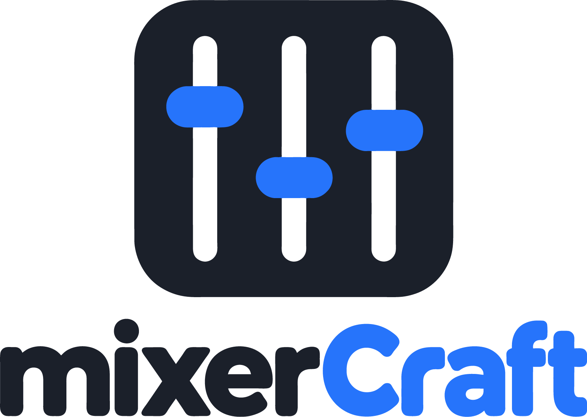
</p>

<h1 align="center">Baixaria Fina</h1>

<p align="center">
  Monorepo com dois produtos para baixistas e músicos: <b>MixerMonster</b> (estúdio de mixagem) e <b>ScaleMonster</b> (formação e prática).
</p>

<p align="center">
  
  
  
  
  
</p>

---

## Sumário

- [Os dois produtos](#os-dois-produtos)
- [Estrutura do repositório](#estrutura-do-repositório)
- [Início rápido](#início-rápido)
- [Comandos](#comandos)
- [Testes e verificação](#testes-e-verificação)
- [Arquitetura](#arquitetura)
- [Documentação](#documentação)
- [Limitações conhecidas](#limitações-conhecidas)
- [Licença e créditos](#licença-e-créditos)

---

## Os dois produtos

| | **MixerMonster** (`mixermonster/`) | **ScaleMonster** (`scalemonster/`) |
|---|---|---|
| Para | Separar, analisar e estudar as faixas de uma música | Estudar escalas, harmonia, percepção auditiva e tocar no palco |
| Plataforma | Windows 10/11 x64 (Electron) | Navegador, desktop (Electron) e Android (Capacitor) |
| Identificador | `br.local.mixercraft` | `br.local.scalemonster` |
| Dados | `%APPDATA%/baixaria-fina` | `%APPDATA%/scalemonster` (desktop); banco próprio no Android |
| Precisa de internet | Não, exceto para baixar por link ou o modelo de voz | Não (100% offline) |

Os dois produtos **não dependem um do outro para funcionar**. O único ponto de contato é o arquivo `.mcraft-pack`: o MixerMonster exporta a linha do baixo de uma música e o ScaleMonster a importa (contrato em [`packages/exchange-contract`](packages/exchange-contract/README.md), na pasta `packages/` compartilhada).

Resumo do que cada um faz:

- **MixerMonster:** importa um arquivo ou link, separa as faixas (Demucs), detecta andamento, compassos, acordes e seções, mostra a linha do baixo no braço, transpõe (Rubber Band), possui simulação de gabinetes acústicos de baixo por Impulse Response (IR convolver no canal do baixo) e exporta mixagem WAV, MIDI e mapa da música.
- **ScaleMonster:** trilhas de escalas e exercícios no braço (baixo, guitarra/violão e teclado/piano com visualizador de teclas em tempo real), ear training, teoria e harmonia, simulação de gabinetes por IR clássicos (Ampeg SVT, Ampeg B15, Hartke XL410, Sunn 200s, TC Electronic 410), treino com palco e juiz de notas, e músicas importadas do MixerMonster.

---

## Estrutura do repositório

O repositório tem duas subpastas de produto, cada uma com o próprio `package.json`, `node_modules`, build e instalador. Os pacotes técnicos compartilhados ficam em uma única pasta na raiz, `packages/`, e cada produto os importa por alias (tsconfig, Vite e Vitest).

```text
mixermonster/      MixerMonster (Electron + React), codebase independente
  src/             main/ (processo principal), preload/, renderer/ (features/, shared/, lib/, styles/)
  tooling/         Python, ffmpeg, Rubber Band, yt-dlp, modelos e roteiros de verificação
  tests/           testes e fixtures
  build/           ícone do instalador
  electron-builder.json, package.json, vite.config.ts, vitest.config.ts, tsconfig.json
scalemonster/      ScaleMonster (web, shell Electron e Android com Capacitor), codebase independente
  src/             features/ (telas por área), shared/, platform/, data/, lib/, domain/, styles/
  shells/desktop/  shell Electron que embrulha o build web
  android/         projeto nativo Capacitor (Gradle)
  tooling/         verificações e ferramentas (responsive-check, gradle, geração de ícones)
  tests/           testes de dados e do domínio
docs/              decisões, notas de versão, próximos passos e capturas
attachments/       imagens de referência
```

**Regra de dependência:** os pacotes (`packages/` na raiz) não conhecem Electron, Capacitor, React nem banco. Os produtos não importam código um do outro. A única ligação é o arquivo `.mcraft-pack`.

**Pacote compartilhado:** `packages/` na raiz é a única fonte de music-theory, audio-synth, ui-core e exchange-contract. Uma mudança ali vale para os dois produtos. Os testes de cada produto cobrem esses pacotes.

---

## Início rápido

Cada produto tem seu próprio `npm install`. Escolha a pasta do produto:

```powershell
git clone https://github.com/iratuan/music_mixer.git
cd music_mixer\mixermonster        # ou: cd music_mixer\scalemonster
npm install
```

**MixerMonster** (desktop):

```powershell
cd mixermonster
npm run build      # renderer (Vite) + processo principal e preload (esbuild)
npm start          # abre o MixerMonster a partir do build
```

**ScaleMonster** (navegador, desktop ou Android):

```powershell
cd scalemonster
npm run dev        # desenvolvimento em http://localhost:5174
```

Para separar, analisar e transpor de verdade no MixerMonster, antes é preciso preparar as ferramentas em [`mixermonster/README.md`](mixermonster/README.md#ferramentas-externas).

---

## Comandos

**MixerMonster** (dentro de `mixermonster/`)

| Comando | Faz |
|---|---|
| `npm run typecheck` / `npm test` | Checagem de tipos e testes (Vitest). |
| `npm run build` / `npm start` | Gera o build e abre o app. |
| `npm run pack:win` | Pasta pronta para testar, em `mixermonster/release/`. |
| `npm run dist:win` | Instalador `mixermonster/release/MixerMonster-Setup-<versão>.exe` e versão portable `MixerMonster-Portable-<versão>.exe` (um arquivo, sem instalar). |

**ScaleMonster** (dentro de `scalemonster/`)

| Comando | Faz |
|---|---|
| `npm run typecheck` / `npm test` | Checagem de tipos e testes (Vitest). |
| `npm run dev` / `npm run build` / `npm run preview` | Desenvolvimento, build web em `dist/` e servidor do build (porta 4174). |
| `npm run desktop:start` | Abre o shell Electron. |
| `npm run desktop:dist` | Instalador `ScaleMonster-Setup-<versão>.exe` e portable `ScaleMonster-Portable-<versão>.exe` (Windows). |
| `npm run android:apk` | APK de depuração. Roda em celulares e tablets Android 7.0 ou mais novos (minSdk 24, alvo 36), de qualquer processador (não tem bibliotecas nativas por arquitetura). Precisa de JDK 21 e Android SDK. |
| `npm run android:release` | AAB de release (assinatura via `gradle.properties`). |
| `npm run check:responsive` | Telas, toque e vídeo do palco em 5 dispositivos. |

**Assinatura de release do ScaleMonster:** o `build.gradle` só assina o release se `gradle.properties` tiver `SCALEMONSTER_KEYSTORE`, `SCALEMONSTER_KEY_ALIAS` e as senhas. As chaves (`*.jks`, `*.keystore`) não são versionadas.

---

## Design System: Dark-Pro Ecosystem & Controles Táteis

Ambos os aplicativos contam com o design system unificado **Dark-Pro Ecosystem** (com modo alternativo **Studio Light Pro**), combinando superfícies escuras de alta densidade (`#0A0A0C` / `#121215`), bordas com chanfro sutil de 1px (`#27272A`), acentos luminosos em índigo/azul elétrico (`#6366F1` / `#3B82F6`) e controles táteis de hardware digital (knobs com graduação radial, switches de ponte com LEDs integrados e pads harmônicos estilo MPC/Launchpad com feedback tátil `inset-shadow`).

<p align="center">
  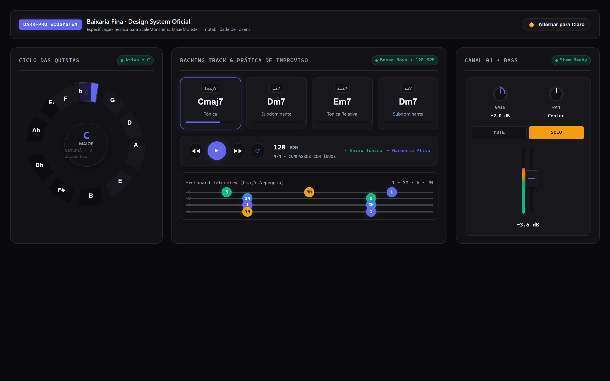
</p>

### Galeria de Telas

| Módulo | Dark-Pro Mode | Studio Light Pro |
|---|---|---|
| **ScaleMonster: Trilhas de Aprendizado Pro** | 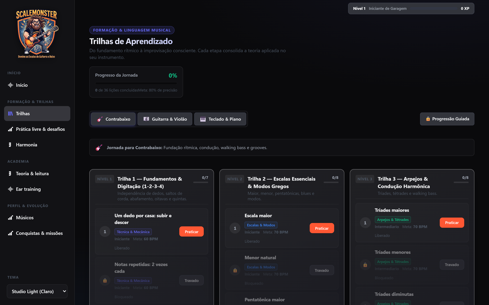 | 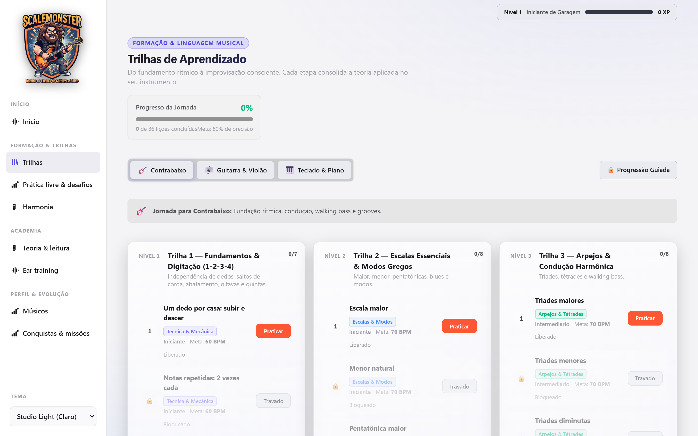 |
| **ScaleMonster: Ciclo das Quintas & Harmonia** | 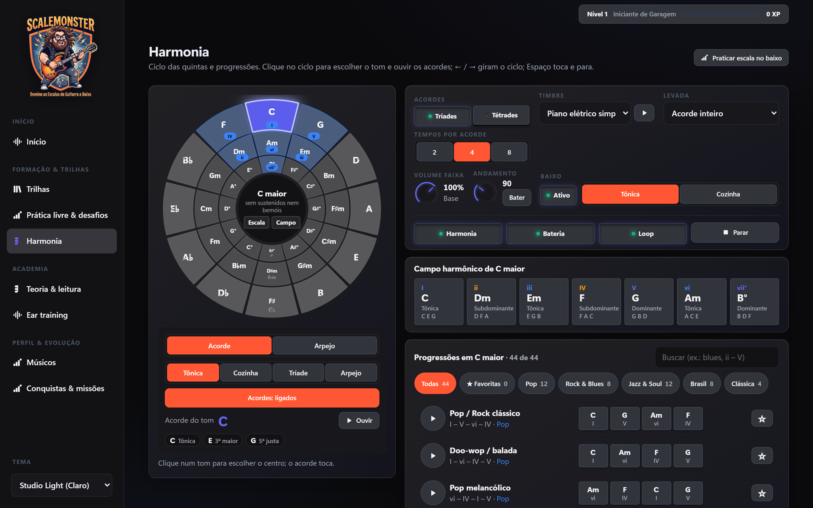 | 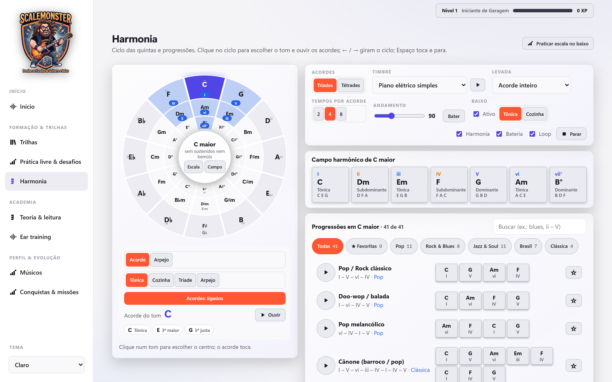 |
| **ScaleMonster: Trilha de Exercícios & Braço** | 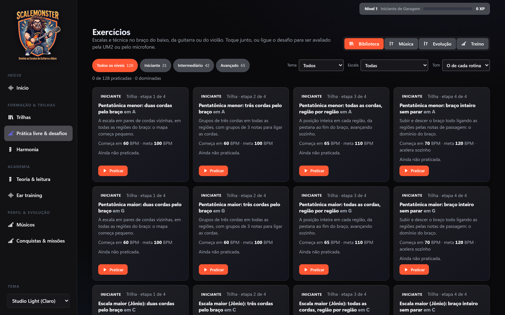 | 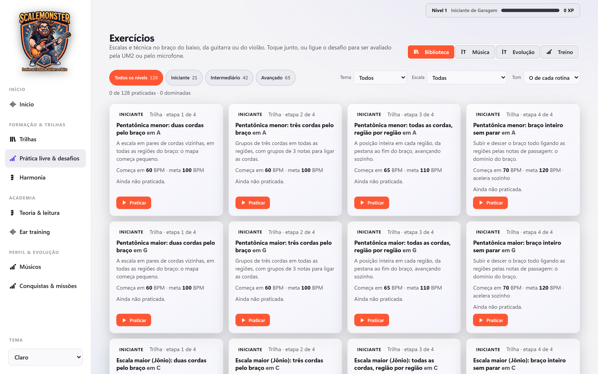 |
| **ScaleMonster: Teoria & Teclado de Piano** | 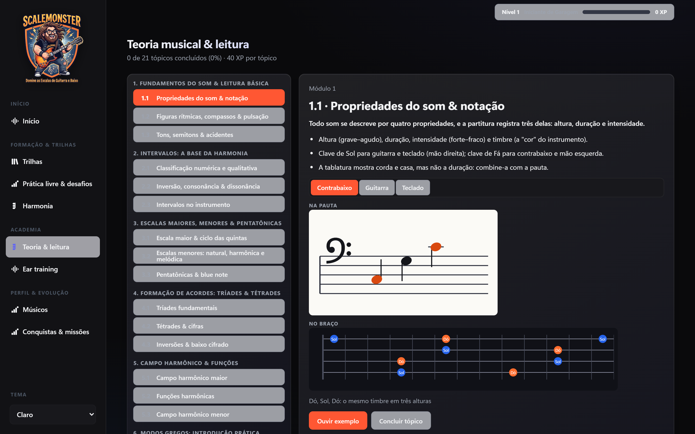 | 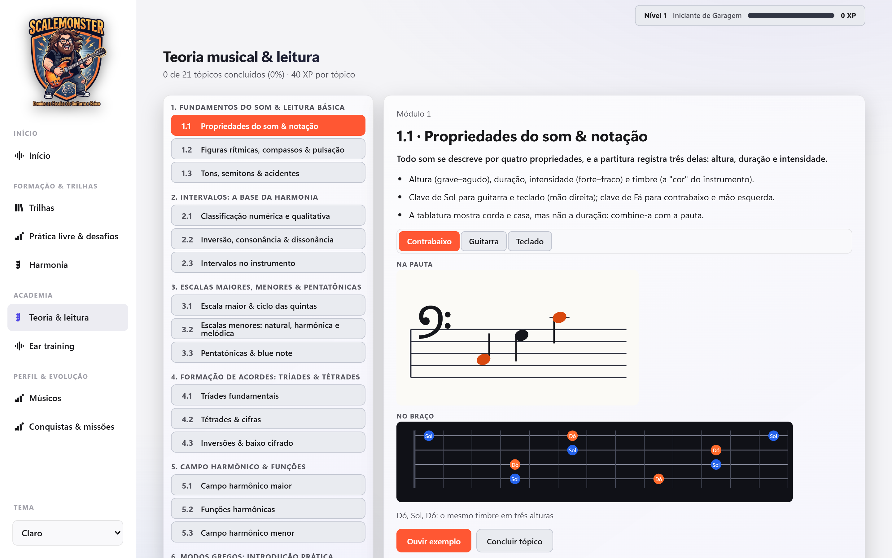 |
| **MixerMonster: Biblioteca de Músicas & Stems** | 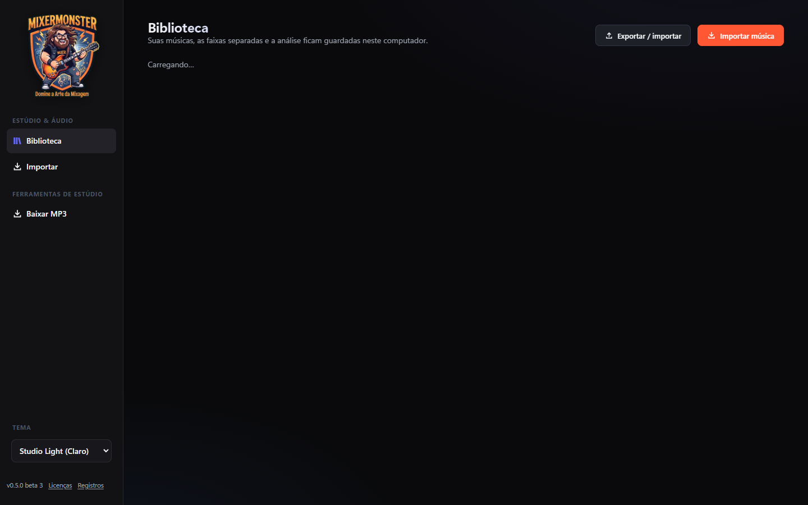 | 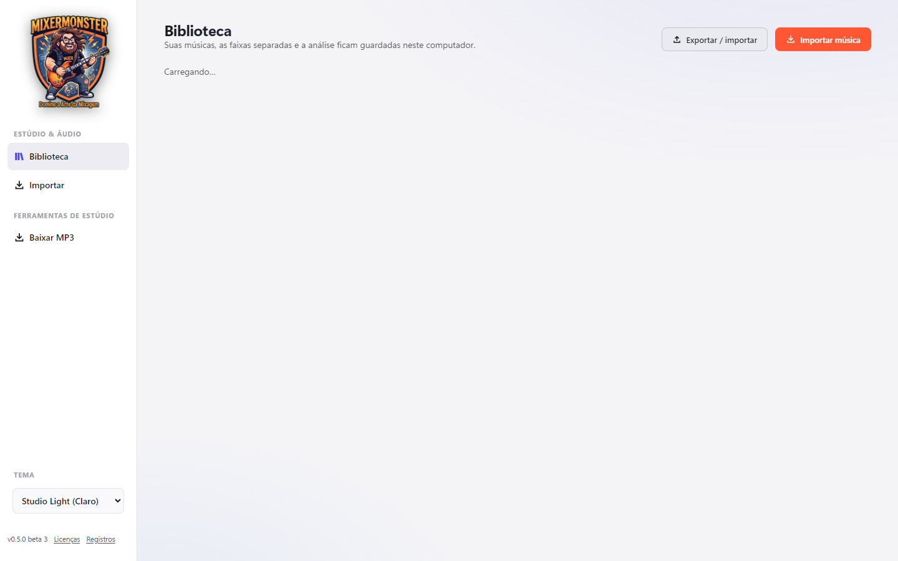 |
| **MixerMonster: Mesa de Mixagem de Stems** | 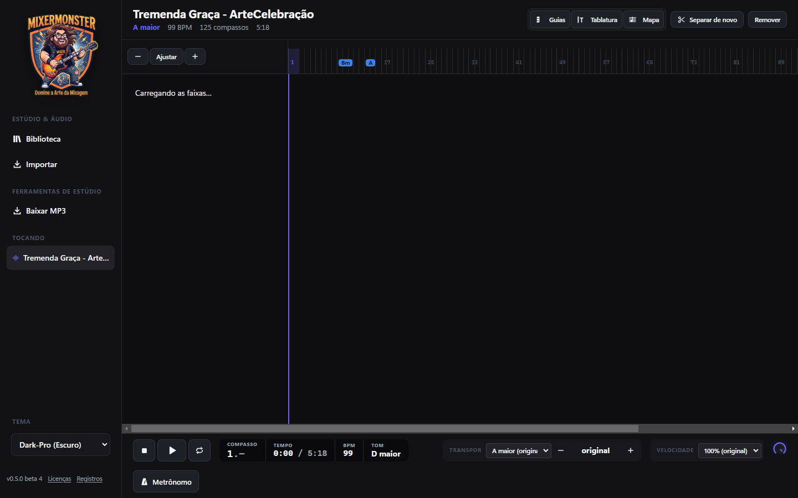 | 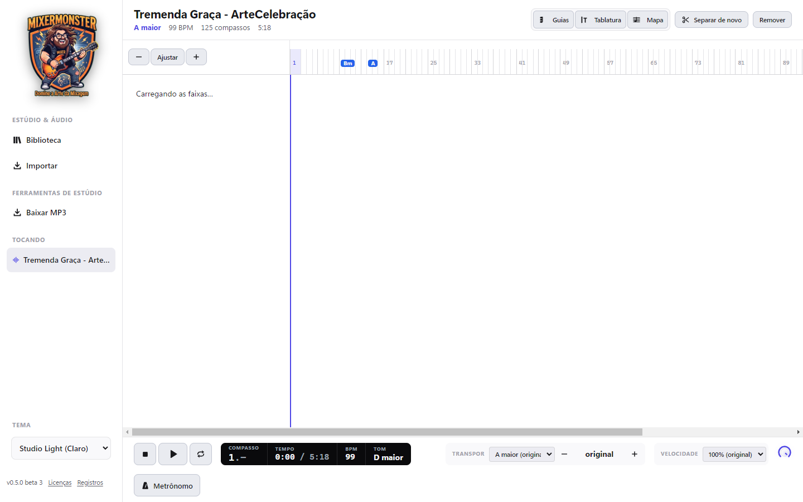 |
| **Tablet Android: ScaleMonster com Jam e Teclado** | 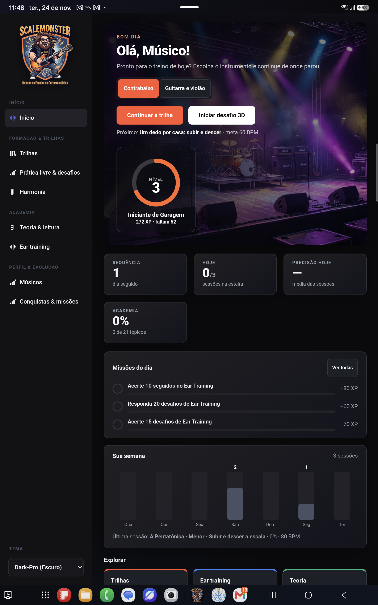 | — |

---

## Novidades desta versão (v0.5.0-beta.6)

- **Suporte a Interfaces de Áudio USB & Baixa Latência (Desktop):**
  - Flags de áudio de alta performance no Electron (`--audio-buffer-size=128`, `--enable-exclusive-audio` e `--disable-features=AudioServiceOutOfProcess`) garantindo áudio WASAPI exclusivo com buffer de ~3ms para interfaces USB (Focusrite Scarlett, Behringer U-Phoria, Steinberg, Zoom, etc.).
  - **Roteamento Inteligente de Canais (L / R / Stereo / Mono):** permite selecionar Entrada 1 (L), Entrada 2 (R) ou Estéreo com duplicação automática para fones de ouvido e monitores sem deixar o som saindo em apenas um lado da orelha.
  - Ícones e identificação clara de interfaces de som USB (`🎛️`) vs microfones convencionais (`🎙️`).
- **Trilhas de Aprendizado Pro para o Músico Integral (`Trails.tsx`):**
  - Redesenho completo no padrão Dark-Pro Ecosystem com seletor de instrumentos (🎸 Contrabaixo, 🎼 Guitarra & Violão, 🎹 Teclado & Piano).
  - Visão geral do músico integral com barra de maestria, contadores de lições e exercícios desbloqueados.
  - Trilhas organizadas por níveis progressivos (Fundamentos, Intermediário, Avançado e Maestria) com badges de categoria (Arpejos, Modos Gregos, Improvisação, Leitura e Harmonia Funcional).
- **Simulação de Gabinete por Impulse Response (Tank-B IRs):** convolver com respostas ao impulso clássicas de caixas de contrabaixo (`Ampeg SVT`, `Ampeg B15`, `Hartke XL410`, `Sunn 200s`, `TC Electronic 410`) integrado tanto na faixa de baixo do MixerMonster quanto nos timbres de acompanhamento e baixo do ScaleMonster.
- **Teclado / Piano nos Exercícios de Escalas:** suporte completo a teclados e pianos nos exercícios e trilhas teóricas (`PianoKeys.tsx`), mapeando notas em tempo real nas oitavas C3 a C6, com timbres dedicados de piano acústico, Rhodes e órgão.
- **Jam Session & Gravação em Harmonia (`Harmony.tsx`):**
  - Controle independente de volume do acompanhamento (`chordLevel`, 0% a 150%) com knob tátil de precisão ao lado do andamento (BPM).
  - Monitoramento de microfone/instrumento ao vivo com baixa latência, seletor de interface/dispositivo de entrada e medidor de nível VU estéreo.
  - Gravação de sessão de prática em tempo real mixando instrumento e playback no barramento master, com player de áudio integrado e exportação/compartilhamento nativo (`@capacitor/share` / `@capacitor/filesystem`).
- **Instaladores Desktop e APK Android:** gerados para Windows x64 (`MixerMonster-Setup-0.5.0-beta.6.exe`, `MixerMonster-Portable-0.5.0-beta.6.exe`, `ScaleMonster-Setup-0.5.0-beta.6.exe` e `ScaleMonster-Portable-0.5.0-beta.6.exe`) e APK instalado e validado diretamente no tablet ancorado via ADB.

## Testes e verificação

- **Automatizados:** `npm test` em cada produto: `mixermonster/` (testes do app e dos pacotes) e `scalemonster/` (testes do app e dos pacotes).
- **Mixer, ponta a ponta:** os roteiros em `tooling/screens/` abrem o app real (Electron + Playwright) com uma biblioteca isolada. Ex.: `node tooling/screens/compact-check.mjs <userData> <id>`.
- **ScaleMonster, interface:** `npm run check:responsive` (em `scalemonster/`) (Chrome ou Edge) confere telas, vídeo do palco e toque nos dispositivos de [`scalemonster/tooling/responsive-check.mjs`](scalemonster/tooling/responsive-check.mjs).
- **Pacote `.mcraft-pack`:** `scalemonster/tooling/pack-import-check.mjs`.

---

## Arquitetura

- **Fronteiras de segurança (Electron):** `contextIsolation`, `sandbox`, CSP, protocolo próprio e canais IPC com lista de permissões. O renderer recebe só o que a interface precisa.
- **Persistência do ScaleMonster:** um `DatabaseAdapter` com sql.js. No navegador o banco fica no IndexedDB; no desktop e no Android, em arquivo, com gravação atômica e backups.
- **Telas do ScaleMonster:** organizadas por área em `src/features/`. Estilos globais ficam em `src/styles/`, na ordem definida em `main.tsx`.
- **Áudio:** síntese e metrônomo em `packages/audio-synth` (na raiz); captura de microfone e juiz de notas no ScaleMonster; player multipista no MixerMonster.

Decisões técnicas estão em [`docs/decisoes.md`](docs/decisoes.md).

---

## Documentação

| Arquivo | Conteúdo |
|---|---|
| [`docs/README.md`](docs/README.md) | Índice da documentação, com o que é atual e o que é histórico. |
| [`docs/decisoes.md`](docs/decisoes.md) | Decisões técnicas e de produto. |
| [`docs/05-two-separate-codebases.md`](docs/05-two-separate-codebases.md) | Separação em dois produtos (monorepo). |
| [`mixermonster/README.md`](mixermonster/README.md) | MixerMonster: status, instalador, ferramentas. |
| [`scalemonster/README.md`](scalemonster/README.md) | ScaleMonster: status, plataformas, comandos. |
| [`packages/`](packages/) | Pacotes técnicos compartilhados pelos dois produtos. |

---

## Limitações conhecidas

**MixerMonster**
- **Só Windows** por enquanto. O código é multiplataforma, mas o empacotamento e as ferramentas estão preparados apenas para Windows x64.
- **Instalador sem assinatura digital.**
- **Acordes com extensões** (9, 11, 13) ainda não são detectados; o modo Completo usa as 9 qualidades atuais.
- **CAGED** é uma aproximação: a forma é escolhida pela corda da raiz e pela facilidade de execução, não por uma tabela fixa das cinco formas.
- **Transposição leva alguns segundos:** cada tom novo gera de novo as faixas com o Rubber Band. O player segue tocando, e vale o último tom pedido.
- **A voz também muda de tom** junto com as demais faixas, inclusive na mixagem exportada.
- **Download por link** depende do `yt-dlp` e das regras do YouTube no momento.

**ScaleMonster**
- **Loop do vídeo do palco no Android:** tocar o loop em emulador trava o app. Problema ainda não resolvido: a escolha entre loop menor ou quadro parado no Android está em aberto.
- **Assinatura de release (AAB):** exige a chave do próprio dono, que não vem no repositório.
- **Web MIDI** não está disponível no WebView do Android.

---

## Licença e créditos

- Código do projeto: **licença ainda não definida** (uso privado).
- Componentes de terceiros têm licenças próprias, inclusive o **Rubber Band** (GPL). Os avisos estão em [`mixermonster/tooling/licenses/`](mixermonster/tooling/licenses/).
- Ferramentas usadas pelo MixerMonster: **Demucs** (separação), **Basic Pitch** (transcrição), **librosa** (análise), **Rubber Band** (transposição), **yt-dlp** (download), **mido** e **pretty_midi** (MIDI). Modelo de voz: Mel-Band RoFormer karaokê (aufr33/viperx).
- O projeto não distribui músicas. Use apenas arquivos e vídeos sobre os quais você tem direito de uso.
